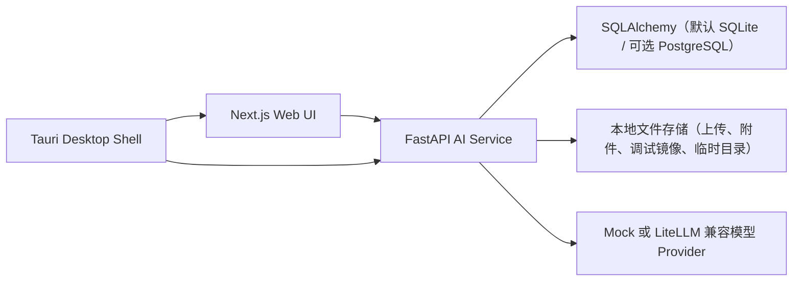

# 系统架构

## 仓库结构

| 模块 | 技术栈与职责 |
| --- | --- |
| `apps/web` | Next.js 16（App Router）Web 前端，负责导航、计划工作区、学习对话、人设与场景编辑、Tavern 房间、设置、用量审计及全局 Debug Overlay |
| `services/ai` | FastAPI 后端，负责数据持久化、文档上传与 OCR、Study Unit 清洗、学习计划生成、Persona/Scene 接口、Study Chat、Tavern 编排及诊断服务 |
| `packages/shared` | 前后端共享 TypeScript 类型契约与标准夹具，覆盖学习记录、Persona/Scene、Character Event、Tavern、诊断与 Harness 证据投影 |
| `apps/desktop` | Tauri 2 桌面壳，集成 Rust Sidecar 启动管理、Stronghold Vault 密钥库、原生 JSON 导出与跨平台安装包构建 |
| `docs` | 面向实现与维护的架构、契约、工作流与运维文档 |

## 运行形态

产品采用本地优先架构，由四个协作边界组成：

- 开发模式下 Web 前端与 FastAPI 后端分进程运行；桌面发布版由 Tauri 打包静态前端与 PyInstaller 生成的后端 Sidecar。
- 结构化业务数据以数据库为权威真源（默认本地 SQLite，设置 `DATABASE_URL` 切换 PostgreSQL）。
- 二进制上传文件、对话附件、调试镜像与临时文件存放在 `services/ai/data/`（或配置的存储根目录）。
- `VIBE_LEARNER_PLAN_PROVIDER=mock` 提供本地确定性运行；`litellm` 通过配置连接真实模型服务。
- 当前系统为单用户本地形态，不含账号认证层、外部异步任务队列、Live2D 渲染引擎或 TTS 服务。

## 应用生命周期

`create_app(settings=...)` 仅构造应用实例，不会在构造期打开数据库连接。其 FastAPI `lifespan` 负责：

1. 构造单个 `Container`（先配置日志，再初始化数据库与 Provider）；
2. 执行显式启动恢复（终结未完成的运行中文档解析与计划生成操作）；
3. 在进程退出或启动失败时取消已注册的流式任务并释放数据库连接池。

HTTP 路由通过 `get_container` 从 `Request.app.state` 获取容器，内部服务则显式接收依赖。同一进程内可同时创建互不干扰的独立应用实例（各自持有独立数据库与配置）。

## 核心职责边界

### Web 前端（`apps/web`）

前端负责界面呈现与客户端工作流协调：

- 文档上传/解析、学习计划生成与修订、学习对话与内嵌 PDF/图片预览；
- Persona Spectrum 与 Scene Setup 结构化编辑器；
- Tavern 房间创建、有序消息流、多角色调度预览、恢复控制与有界历史分页；
- 响应数据的 `snake_case → camelCase` 严格解码（从 `unknown` 校验，fail-closed）与过期异步结果围栏（`async-result-fence`）；
- 挂载在根布局 `apps/web/app/layout.tsx` 的全局 `DebugOverlay`，按当前页面路由实时消费页面级调试适配器与全局诊断时间线。

状态边界按域隔离：

- **学习域**（`/plan` 与 `/study`）：共享 `(learning)` 路由组内的 `LearningWorkspaceProvider`，内部拆分为页面组合、Controller Hook、Reducer、纯状态工具、页面草稿缓存与展示映射。详见 [前端页面边界与分层](frontend-learning-workspace.md)。
- **Tavern 域**（`/tavern`）：独立拥有页面组合、面板、Controller Hook（查询/恢复/变更分离）、可注入端口、严格解码器与单调状态合并层。
- **独立配置与编辑器页面**（`/persona-spectrum`、`/scene-setup`、`/settings`、`/sensory-tools`、`/model-usage`）：各自按域加载数据，不触发学习域初始化。

### AI 后端（`services/ai`）

后端拥有应用身份、持久化事务、模型编排与权威状态变更：

- 管理 Document、Learning Plan、Study Session、Persona、Scene、Runtime Settings、Token Usage、Tavern 与诊断记录；
- 执行 PDF 文本抽取、按需 OCR 与 Study Unit 清洗；
- 组装 Planning Context 与受控工具环境，记录模型与工具调用 Trace；
- 通过独立边界分别编译教学 Persona 与 Tavern Persona Prompt；
- 为 Study Chat 返回结构化回复、教材引用、Character Events 与服务端受保护交互题；
- 拥有 Tavern 说话人调度顺序、Run 谱系、单调消息序号与房间修订号，逐角色验证并提交输出。

模型 Schema 只能提出内容与有界效果提案；所有应用 ID、说话人身份、修订号、序号、时间戳与已提交状态一律由服务端分配与校验。

### 共享契约与 Harness（`packages/shared`）

`packages/shared` 维护前端消费的 TypeScript 契约与跨语言标准夹具；后端 Python Pydantic 模型为线上契约权威。

Harness 是覆盖全仓库的统一执行生命周期，适用于 Document/OCR/Study Unit、Planning、Persona/Scene、Study Chat 与 Tavern：

1. 构造强类型、有界的输入；
2. 快照并摘要版本化上下文，按操作授权读取受保护内容；
3. 调用不可靠的模型或启发式执行器；
4. 严格解码领域提案；
5. 校验领域不变量；
6. 在严格上限内执行有界恢复；
7. 原子提交已验证效果，或持久化终态失败证据；
8. 产出不可变 Trace 证据。

详见 [Harness 工程手册](harness/README.md)。

## 主业务流程概览

### 1. 教材入库与解析

1. `POST /documents` 预检文件大小与物理页上限，保存 PDF 并单行插入 Document 记录。
2. `POST /documents/{id}/process`（或 `/process/stream`）在同一事务中准入处理操作与 Harness 绑定，并将文档置为 `processing`。
3. 解析器逐页抽取文本、按需执行 OCR、提取原始 Section 与 Chunk，并保存操作围栏内的断点（Checkpoint）。
4. 编排清洗服务将原始 Section 归一化为可供规划的 `StudyUnitRecord[]`。
5. 单个数据库事务原子提交 Document 投影、Debug 投影、投影摘要与终态操作回执；失败时恢复至处理前基线并保留断点供显式续跑。

详见 [教材解析与入库链路](document-pipeline.md)。

### 2. 学习计划生成与修订

1. `GET /documents/{id}/planning-context` 提供清洗后的 Study Units、详情映射与可用规划工具列表。
2. `POST /learning-plans`（或 `/learning-plans/stream`）携带稳定 `client_request_id` 与文档水印准入操作。
3. 后端先生成确定性启发式计划，再由模型结合 6 个受控规划工具迭代细化并输出严格的 `LearningPlanProposalV3`。
4. 若模型通过 `revise_study_units` 提出教材单元重划建议，系统保存保守计划与独立待确认预览，不静默覆盖教材。
5. 单事务原子提交 Learning Plan、关联投影、Planning Trace 与操作回执；后续修订与回滚通过独立的预览/确认流程与 Plan CAS 执行。

详见 [学习计划链路与契约](learning-plan.md)。

### 3. 场景生成与保存

1. `POST /scene-setup/generate` 将模型输出严格解码为 `scene-tree-proposal-v1`（不含任何应用 ID），校验树深度、节点数与文本预算后由服务端分配所有 committed ID 并返回候选树。
2. 用户编辑或保存至草稿/场景库时，通过 `scene-committed-save-v1` 与 `expected_revision` 执行行级 CAS，服务端根据校验后的树重新生成 `SceneProfile`。

详见 [场景编辑器](scene-setup.md)。

### 4. 学习对话（Study Dialog）

1. `POST /study-sessions` 按 `(document_id, persona_id, study_unit_id)` 作用域创建或恢复会话。
2. `POST /study-sessions/{id}/chat`（及附件端点）携带 `client_request_id` 与 `expected_session_revision` 先做持久化准入，再通过 `StudyChatApplication` 执行受保护快照解析、32 个注册工具调用与强类型效果准备（`effect_state=prepared`）。
3. 单个数据库事务原子提交新 Turn（应用分配 ID 与连续序号）、Session 修订号推进、数据库内效果、操作回执与终态 v3 Trace；交互题评分材料仅存于服务端，作答通过 `POST /study-sessions/{id}/attempt` 独立判分提交。
4. 浏览器在模糊网络结果下只查询原操作回执，不重放未知副作用。

详见 [学习会话与对话恢复](study-session.md)。

### 5. Tavern 多角色互动

1. `POST /tavern/rooms` 以幂等键创建独立房间并冻结参与者 Persona 快照。
2. `POST /tavern/rooms/{id}/turns` 在房间 `expected_revision` 上执行直接（单人）或引导式（多人）回合，服务端按参与者 `display_order` 固定说话顺序。
3. 每个角色步骤在数据库时钟租约与认领计数围栏内逐个生成、严格解码并单条追加消息；部分失败时保留已提交消息，未完成步骤可通过作用域子重试（child retry）继续。
4. 取消操作立即落库围栏阻止后续提交与恢复，并在兼容的异步 HTTP 传输上中止本地连接。

详见 [Tavern 多角色互动](tavern.md)。

## 角色表现层

结构化 `CharacterEvent` 协议预留 `emotion`、`action`、`intensity`、`speech_style`、`scene_hint`、`line_segment_id` 与 `timing_hint` 字段。前端角色层消费结构化事件而不从台词正文中正则解析指令，当前由占位渲染器承接，保持学习 UI、角色表现与调试证据解耦。

## 持久化布局

### 数据库（权威真源）

数据库由 SQLAlchemy 管理（SQLite 默认 + Alembic 迁移支持 PostgreSQL），核心表包括：

- **业务聚合**：`documents`、`document_debug_records`、`learning_plans`、`learning_plan_revisions`、`study_sessions`、`study_question_attempts`、`personas`、`persona_cards`、`scene_setup_states`、`scene_library_entries`、`reusable_scene_nodes`、`session_scene_states`；
- **操作与检查点**：`document_process_operations`、`document_checkpoints`、`document_checkpoint_resumes`、`learning_plan_operations`、`plan_revision_operations`、`study_unit_revision_operations`、`study_chat_operations`；
- **Tavern 规范化表**：`tavern_rooms`、`tavern_participants`、`tavern_messages`、`tavern_runs`、`tavern_run_steps`；
- **系统与统计**：`runtime_settings`、`model_tool_configs`、`planning_traces`、`stream_reports`、`token_usage_records`；
- **Harness 基础设施**：`harness_operation_bindings`、`harness_workflow_operations`、`harness_runtime_executions`、`harness_artifact_*`、`harness_effect_*`。

`LocalJsonStore` 为兼容封装层，部分聚合会在数据库提交后尽力写入 JSON 镜像，但文件镜像不构成提交边界；Documents、Learning Plans、Study Sessions 与 Tavern 均由各自 Repository 以行级写入与修订号 CAS 管理。

### 本地文件目录（`services/ai/data/`）

| 目录 | 用途 |
| --- | --- |
| `uploads/` | 上传的原始教材 PDF |
| `chat_attachments/` | Study Chat 上传附件与操作级暂存目录 |
| `document_debug/`、`planning_trace/` | 解析与规划调试兼容镜像 |
| `document_process_stream/`、`learning_plan_stream/` | 有界流式进度快照 |
| `diagnostics/` | 独立诊断事件库、Harness 索引库与桌面原生 Spool 目录 |
| `_tmp/`、`cache/` | OCR 临时文件与可清理缓存 |

## 全局 Debug Overlay 与所有权

全局 `DebugOverlay` 分为**当前页调试视图**与**全局诊断视图**：

- **当前页调试**：通过 `apps/web/components/owned-debug-snapshot.tsx` 接入内存态页面适配器。注册绑定当前 `page_view_id` 与私有 owner token，只有所有者可更新或清理快照；路由切换时立即隐藏不匹配快照，不加载其他业务域数据，也不把大体积页面内容写入诊断事件。
- **全局诊断**：按需分页读取后端诊断事件、Harness 索引、操作关联、存储状态与审计导出。切换筛选条件或离开视图会中止在途请求并围栏过期响应；事件视图最多保留 500 行、索引视图最多 250 行。所有诊断投影均不构成业务提交证据，详见 [诊断与审计体系](diagnostics.md)。
