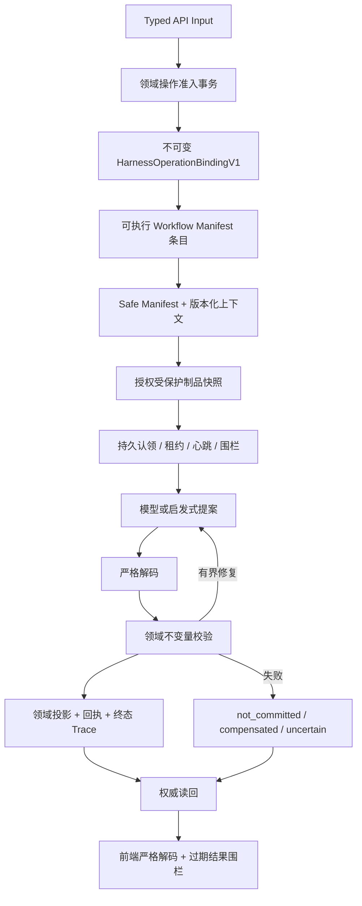
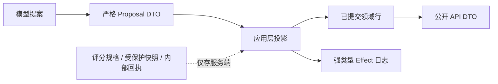

# Harness 工程手册

本目录维护 Harness 运行时生命周期、数据库映射、配置与预算以及各业务工作流的执行边界。核心约束见 [AGENTS.md](../../AGENTS.md)，共享表结构见 [数据库映射](database.md)，预算与配置见 [配置与预算](configuration.md)。

## 用户工作流索引

| 用户工作流 | Workflow / 入口 Stage | 详细文档 |
| --- | --- | --- |
| 上传并处理教材 | `document_parse:document_parse`（含 page extraction、section detection、chunk building、OCR、Study Unit cleanup 子阶段） | [Document / OCR / Study Unit](document-processing.md) |
| 生成/修订学习计划、确认单元建议 | `planning:plan_generation`、`planning:planning_tool_execution`、`planning:plan_revision`、`planning:study_unit_revision` | [Planning](planning.md) |
| 生成人设卡与辅助编辑 | `persona:persona_generation` | [Persona Generation](persona-generation.md) |
| 生成场景树 | `scene:scene_generation` | [Scene Generation](scene-generation.md) |
| Study Dialog 教学对话 | `study_chat:study_chat_reply` | [Study Chat](study-chat.md) |
| Tavern 多角色互动 | `tavern:actor_reply` | [Tavern](tavern.md) |
| 浏览器严格解码 | `frontend_decode:response_decode` | 本页“前端边界” |

## 统一生命周期

顺序不可颠倒：

1. 先由领域操作准入在同一数据库事务内分配不可变 Harness 身份，再构造上下文；
2. 受保护内容必须经过 operation-scoped grant 授权方可读取；
3. 模型仅产出 proposal，所有应用 ID、修订号、序号、时间戳与已提交投影均由应用层分配；
4. 仅登记 Manifest 或构造夹具属于路由/配置证据，不代表生产采用。

## 三组上限的区分

| 上限类型 | 归属 | 作用说明 |
| --- | --- | --- |
| 生命周期尝试上限 | `HarnessManifestAttemptCeilingV1`（`max_attempts=3`、`max_repair_attempts=2`） | 限制 Harness runtime 的 generate/repair 生命周期记录次数 |
| 工作流登记预算 | `HarnessManifestExecutionBudgetV1` | 通用执行 wall time 与 per-call timeout；工具次数由 Tool Manifest 执行；`max_provider_calls` / `max_input_tokens` / `max_output_tokens` 为登记与审计字段 |
| Provider 循环与传输重试 | Provider 运行器与 `ProviderTransport` | 决定真实发出的模型逻辑/物理请求次数，详见 [配置与预算](configuration.md) |

## 模型输出所有权

- 模型不得生成 committed ID、speaker identity、revision、sequence、timestamp 或 effect receipt。
- Scene 与 Persona 生成仅产出候选内容，用户保存属于独立的 CAS 写边界。
- Study 交互题评分规格在提交前仅存在于服务端。
- Tavern 角色提案不得冒充其他参与者，且提交策略为 `primary_output_only`（仅证明单条主消息，不涵盖事务中所有 Room/Run/Step 副作用）。

## 前端边界

前端通过 `apps/web/lib/*-decode.ts` 对当前响应与历史读回做 fail-closed 解码，用于防线兜底而非替代后端 Pydantic 校验。像 Scene 尺寸预算这类跨语言约束由后端 `services/ai/app/models/scene.py` 拥有权威定义，TypeScript 侧保持镜像一致。

## 权威代码入口

| 边界 | 代码位置 |
| --- | --- |
| Workflow / Stage / Contract 清单 | `services/ai/app/models/harness_manifest.py`、`packages/shared/fixtures/harness/workflow-manifest-v1.json` |
| Operation Identity | `services/ai/app/models/harness_operation.py`、`services/ai/app/persistence/harness_operation_repository.py` |
| Durable Runtime | `services/ai/app/services/harness_runtime.py`、`services/ai/app/services/harness_broad_adoption.py` |
| 受保护制品与效果日志 | `services/ai/app/persistence/harness_artifact_repository.py`、`services/ai/app/persistence/harness_effect_repository.py` |
| Provider 运行时限制 | `services/ai/app/core/model_runtime_limits.py` |
| Tool Manifest | `services/ai/app/models/tool_manifest.py`、`packages/shared/fixtures/harness/tool-manifest-v1.json` |
| Commit Policy | `services/ai/app/models/harness.py`、`packages/shared/fixtures/harness/operation-commit-policies-v1.json` |

验证入口：`npm run test:baseline`（不变量基线）与 `npm run check`（完整门禁）。
