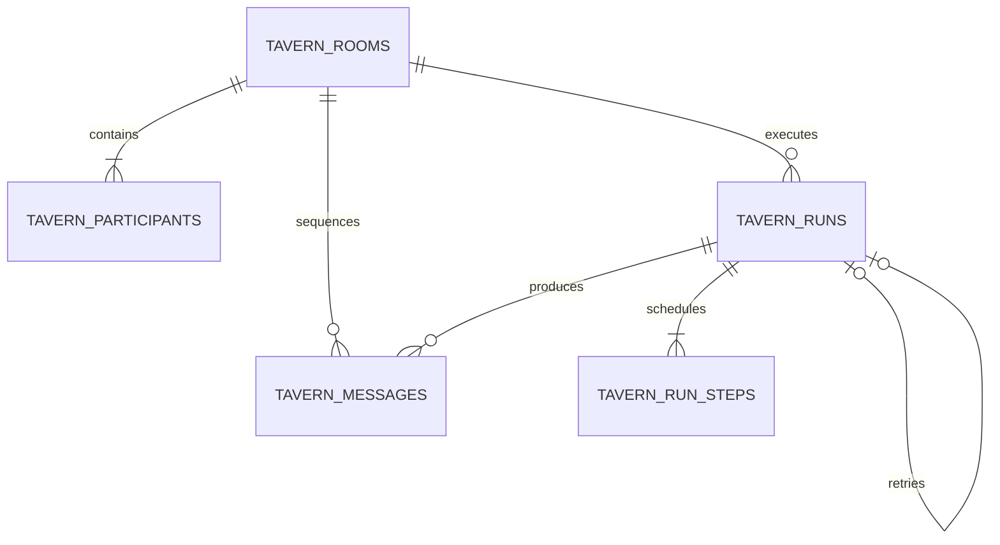

# Tavern 多角色互动

Tavern 是独立于 Study Session 的自由对话与多角色互动领域：复用已保存的 Persona 与 Scene 快照，不依赖教材、学习计划、引用或 Study Unit。其 Harness 执行边界见 [Tavern Harness](harness/tavern.md)。

## 1. 核心术语

| 术语 | 含义 |
| --- | --- |
| `Tavern Room` | 持久化互动房间，包含可选 Scene 快照、角色阵容、单调修订号 `revision` 与单调消息序号 `last_sequence` |
| `Tavern Participant` | 房间级不可变 Persona 快照（`persona_snapshot` + `prompt_hash`），源 Persona 后续修改不影响已有房间 |
| `Tavern Message` | 仅追加（append-only）消息，归属 `user` / `persona` / `director` / `system`，服务端独占 `author_kind`、归属与单调序号 |
| `Tavern Run` | 单次幂等生成尝试，记录触发器、服务端排序的调度表、上下文摘要、重试谱系、终态序号与 Harness Trace |
| `Tavern Speaker Step` | 单个计划内角色尝试，状态为 `pending` / `generating` / `completed` / `failed` / `blocked` / `canceled` |

## 2. 规范化存储模型

- `tavern_rooms`：房间标题、场景快照、Harness 策略、状态（`active`/`archived`）、修订号、末条序号与创建请求摘要。
- `tavern_participants`：按 `display_order` 排序的阵容，每 `(room_id, persona_id)` 唯一。
- `tavern_messages`：仅追加消息，`(room_id, sequence)` 唯一；角色消息同事务持久化服务端私有操作/效果回执元数据（不暴露于公开 API）。
- `tavern_runs`：`(room_id, idempotency_key)` 唯一；可选唯一 `parent_run_id` 强制自外键，确保每个失败/部分失败 Run 至多有一个直接子重试。
- `tavern_run_steps`：复合主键 `(run_id, step_index)`，记录唯一角色/消息归属、reply anchor、状态、Trace、数据库时钟租约（owner/expiry）与认领计数（`claim_count`）。

持久化全部由拆分后的 Tavern Repository 模块（`services/ai/app/persistence/tavern_*.py`）通过结构化 SQLAlchemy DML 实现，不使用集合级 `LocalJsonStore.save_list`。受管事务在连接 DML 边界自动收集涉及的 Room/Run/Message 身份并在外层提交前由 `transaction_validation.py` 校验全部软引用一致性（SQLite Savepoint 自动建立外层事务，避免过早释放非法数据）。

## 3. 回合调度、恢复与子重试

### 触发与排序

`POST /tavern/rooms/{room_id}/turns` 支持两种模式与两种触发器：

- **模式**：`direct`（1 个目标参与者）与 `facilitated`（2–4 个不重复参与者，受房间 Harness 策略上限约束）。
- **触发器（`input`）**：`user_message`（追加可见用户消息）或 `continue`（锚定 `anchor_message_id`，不伪造用户/导演消息；锚点过期返回 `409 tavern_continue_anchor_stale`）。
- **服务端固定排序**：`target_persona_ids` 语义上是**集合**——相同目标集合的不同排列共享同一个请求摘要；服务端按房间阵容 `display_order` 生成 `scheduled_participant_ids` 并逐角色提交。
- **独立 Persona 编译器**：Tavern 拥有独立于教学模式的 Persona 编译器，保留角色锚点、关系与称呼，移除教材教学约束；用户可编辑的 Persona 文本作为低信任定界数据传入，系统层仅保留平台不变量与严格输出 Schema（`TavernActorReply`）。

### 租约、部分失败与子重试

- **逐角色原子提交**：首角色失败记为 `failed`；后续角色失败记为 `partial`，保留前置已提交角色消息，将当前步标记为 `failed`、剩余步标记为 `blocked`。
- **数据库时钟租约与接管**：每个生成中步骤持有数据库时钟租约与心跳；进程中断后可在租约过期时通过 `POST .../resume` 以新 fencing epoch 接管；单步最多 3 次认领（初始 + 2 次接管），耗尽后以 `tavern_run_claims_exhausted` 终结。
- **作用域子重试（`POST .../runs/{run_id}/retry`）**：仅接受终态 `failed` / `partial` 且尚未有直接子 Run 的源 Run，仅调度未完成的 `failed`/`blocked` 角色（不追加新用户消息，不重复已完成角色，首个子角色锚定上一条已提交角色消息）。若房间已归档，或修订号、末条序号、上下文摘要、阵容顺序或参与者 Prompt Hash 任一变化，返回 `409`。
- **权威恢复视图**：`GET /tavern/rooms/{room_id}/run-recovery` 基于完整谱系返回每条根链路的权威 `leaf_run`、链路状态与可执行恢复动作（独立于有界 `GET .../runs` 最近窗口）。
- **502 受控重放**：模型/Harness 失败在落库终态证据后返回 `502`，携带结构化 `{code, run_id, child_run_id, current_revision, recovery_action}`。浏览器**仅**在 `recovery_action === "replay_same_request"` 且带 `run_id` 时，以完全相同的 URL、Body、修订号与幂等键自动重放一次，读取已落库的 `200` 终态回执（不重新调用模型）。客户端始终依据 `run.status` 判定业务结果。

## 4. 前端 Interaction Composer 顺序契约

- 进行中的回复对象预览由当前待定服务端 Run 的 `scheduled_participant_ids` 派生（准入可见前暂用前台提交目标），并始终按房间阵容 `display_order` 展示。
- 在途回合的目标不会覆盖用户为下一轮选择的参与者集合；若某参与者已被选为下轮目标但不在当前在途调度中，界面明确标注“下轮目标”。
- 回合进入终态后，预览恢复显示下轮已选集合。前端所有聚合响应均经 `apps/web/lib/tavern-decode.ts` 从 `unknown` 严格解码，状态合并遵循单调性（终态 Run 不可退回 `pending`）。

## 5. 取消边界与可取消 HTTP 传输

Tavern 将**数据库取消围栏**与**本地传输取消**严格分离：

1. **数据库围栏优先**：`POST /tavern/rooms/{room_id}/runs/{run_id}/cancel` 幂等地将待定 Run 及其未完成步骤原子置为 `canceled`，立即阻止后续消息提交、回退修复与恢复；迟到的失败证据仅按当前 `claim_count` 附加至已取消步骤，不改变状态或追加消息。
2. **传输取消能力路由**（`services/ai/app/services/provider_cancellation.py`）：

| 适配器 | 本地 HTTP 传输取消 | 停止上游计算/计费 |
| --- | --- | --- |
| `compatible-chat-http-v1`（`provider_http_chat.py`） | 支持（独立 `httpx.AsyncClient` 与事件循环） | 不支持 / 无法证实 |
| `litellm-sync` | 不支持（发出同步请求后依赖超时与提交围栏） | 不支持 / 无法证实 |
| 其他自定义 Provider | 不支持 | 不支持 / 无法证实 |

- `compatible-chat-http-v1` 仅用于解析到 OpenAI 兼容 Chat Completions 协议的 Tavern 角色调用（`openai/` 路由、自定义兼容 Base URL 或标准 OpenAI v1 Base URL）；`anthropic/`、`gemini/`、Azure、Bedrock 及非 Tavern 工作流保留原有 LiteLLM SDK 路径。
- 在等待响应头或响应体期间，适配器每 250 ms 检查一次认领/租约谓词（含仓库查询与调度延迟，非硬实时 SLA）；检测到取消或失租后立即取消异步任务、关闭连接与客户端并把工作线程归还线程池，不编造已取消请求的 Token 用量。
- 取消响应证明数据库围栏生效，不代表上游供应商已停止计算或免除计费，UI 文案如实传达此边界。
